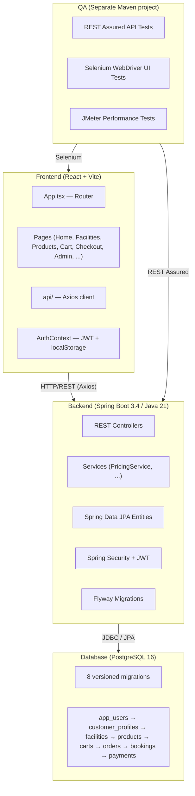
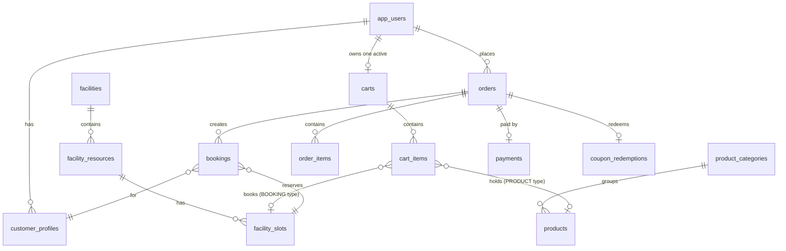
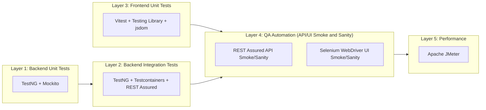
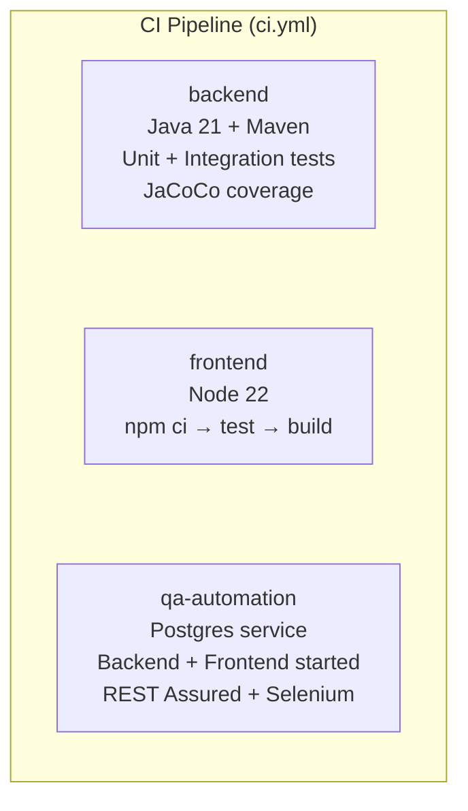

# SportHub — Architecture Overview

> **"One platform. Two commerce experiences. One checkout."**

SportHub is a full-stack sports facility booking and merchandise e-commerce platform. Customers can browse & book sports facility time-slots (badminton, tennis, basketball, futsal, swimming) **and** purchase sporting goods — all through a unified cart and checkout flow with demographic-based pricing, coupons, and simulated payments.

---

## High-Level Architecture



---

## 1. Backend — Spring Boot 3.4 / Java 21

| Aspect | Detail |
|---|---|
| **Framework** | Spring Boot 3.4.5 (spring-boot-starter-web, data-jpa, security, validation, actuator) |
| **Language** | Java 21 |
| **Build** | Maven (`pom.xml`), single module |
| **Entry Point** | [`SportHubApplication.java`](backend/src/main/java/com/sporthub/SportHubApplication.java) |
| **Config** | [`application.yml`](backend/src/main/resources/application.yml) — env-var driven (DATABASE_URL, JWT_SIGNING_SECRET, etc.) |
| **API docs** | springdoc-openapi (`/v3/api-docs`), protected behind Spring Security |

### Source Structure

```
backend/src/main/java/com/sporthub/
├── SportHubApplication.java          # @SpringBootApplication entry point
├── common/
│   ├── ApiErrorResponse.java         # Standardised error response record
│   └── GlobalExceptionHandler.java   # @RestControllerAdvice — validation + 500 errors
└── pricing/
    └── PricingService.java           # Pure business logic: age classification + demographic discounts
```

> [!NOTE]
> The backend is still **early-stage** — only 4 source files exist. The `PricingService` is a pure (no-Spring-dependency) service implementing demographic pricing rules:
> - **Child** (<18): 20% discount
> - **Senior** (≥60): 15% discount
> - **Adult**: full price

### Key Design Decisions

- **Hibernate `ddl-auto: validate`** — schema is managed exclusively by Flyway, not Hibernate auto-DDL
- **JWT authentication** using jjwt (io.jsonwebtoken), with configurable secret and expiration
- **Simulated payments** — the payment outcome is configurable via `SIMULATED_PAYMENT_OUTCOME` env var
- **Timezone**: Asia/Singapore (Jackson serialization)
- **Docker**: [`compose.yaml`](backend/compose.yaml) available for local development

---

## 2. Frontend — React 18 / TypeScript / Vite

| Aspect | Detail |
|---|---|
| **Framework** | React 18.3 with TypeScript 5.7 |
| **Build** | Vite 6.0 + @vitejs/plugin-react |
| **Routing** | react-router-dom v6 (BrowserRouter) |
| **HTTP Client** | Axios with JWT bearer token interceptor |
| **Icons** | lucide-react |
| **State** | React Context (`AuthContext`) + localStorage for auth persistence |

### Source Structure

```
frontend/src/
├── App.tsx                  # Top-level router with all routes
├── main.tsx                 # ReactDOM entry point
├── styles.css               # Global stylesheet
├── api/
│   ├── client.ts            # Axios instance, interceptors, error helpers
│   └── index.ts             # API modules: authApi, facilityApi, productApi, cartApi, orderApi, bookingApi, adminApi
├── components/UI.tsx        # Shared UI components
├── contexts/AuthContext.tsx # Auth state provider (JWT + user in localStorage)
├── hooks/                   # Custom React hooks
├── layouts/AppLayout        # App shell/layout wrapper
├── pages/
│   ├── Pages.tsx            # All page components in one file
│   ├── Pages.test.tsx       # Unit tests for pages
│   ├── admin/               # Admin page components
│   ├── auth/                # Login, Register
│   ├── bookings/            # Booking management
│   ├── cart/                # Shopping cart
│   ├── checkout/            # Checkout flow
│   ├── facilities/          # Facility browsing & detail
│   └── products/            # Product browsing & detail
├── routes/Guards.tsx        # CustomerGuard, AdminGuard (role-based route protection)
├── types/index.ts           # TypeScript type definitions
└── utils/                   # Utility functions
```

### Route Map

| Route | Component | Access |
|---|---|---|
| `/` | Home | Public |
| `/facilities` | Facilities | Public |
| `/facilities/:id` | FacilityDetail | Public |
| `/products` | Products | Public |
| `/products/:id` | ProductDetail | Public |
| `/login` | Login | Public |
| `/register` | Register | Public |
| `/cart` | CartPage | Public |
| `/checkout` | Checkout | Customer only |
| `/order-confirmation` | Confirmation | Customer only |
| `/bookings` | Bookings | Customer only |
| `/orders` | Orders | Customer only |
| `/account` | Account | Customer only |
| `/admin` | AdminPage | Admin only |
| `/admin/:section` | AdminRoute | Admin only |

### API Client Architecture

The [API client](frontend/src/api/client.ts) uses Axios with:
- **Request interceptor**: automatically attaches JWT from `localStorage` as `Bearer` token
- **Response interceptor**: on 401, clears auth state and dispatches `sporthub:unauthorized` event
- **Base URL**: configurable via `VITE_API_BASE_URL` env var (defaults to `http://localhost:8080/api/v1`)

---

## 3. Database — PostgreSQL 16

### Migration Strategy

- **Tool**: Flyway (integrated into Spring Boot)
- **8 versioned SQL migrations** in [`database/migrations/`](database/migrations)
- Migrations are stored **outside** the backend, shared as a project-level concern
- Schema is referenced from backend via `filesystem:../database/migrations`

### Schema Overview (8 migrations)

| Migration | Tables Created |
|---|---|
| [V1](database/migrations/V1__create_identity_and_profiles.sql) | `app_users`, `customer_profiles` |
| [V2](database/migrations/V2__create_facilities_and_resources.sql) | `facilities`, `facility_resources` |
| [V3](database/migrations/V3__create_products_and_inventory.sql) | `product_categories`, `products` |
| [V4](database/migrations/V4__create_discount_policies_and_coupons.sql) | Discount policies, coupons |
| [V5](database/migrations/V5__create_carts_and_cart_items.sql) | `carts`, `facility_slots`, `cart_items` |
| [V6](database/migrations/V6__create_orders_bookings_and_payments.sql) | `orders`, `bookings`, `order_items`, `coupon_redemptions`, `payments` |
| [V7](database/migrations/V7__create_indexes_and_integrity_constraints.sql) | Additional indexes and constraints |
| [V8](database/migrations/V8__seed_demo_catalogue.sql) | Demo seed data (5 facilities, products) |

### Entity Relationship Diagram



### Key Constraints

- **One confirmed booking per slot**: `UNIQUE INDEX uq_bookings_confirmed_slot ON bookings(facility_slot_id) WHERE booking_status = 'CONFIRMED'` — enforces at the DB level that a slot cannot be double-booked
- **One active cart per user**: `UNIQUE INDEX uq_carts_one_active_per_account ON carts(account_user_id) WHERE status = 'ACTIVE'`
- **Idempotent checkout**: `UNIQUE(account_user_id, idempotency_key)` on orders
- **Polymorphic cart items / order items**: `item_type` CHECK constraint distinguishes `BOOKING` vs `PRODUCT` with appropriate FK nullability

---

## 4. Testing Architecture

The project has testing at five scopes—backend unit, backend integration, frontend component, external API/browser automation, and performance—across separate projects. This diagram shows learning/debugging relationships; CI runs backend, frontend and QA jobs in parallel:



---

### 4.1 Backend Unit Tests (TestNG + Mockito)

| Aspect | Detail |
|---|---|
| **Framework** | TestNG 7.10.2 (JUnit excluded from spring-boot-starter-test) |
| **Mocking** | Mockito (with inline MockMaker) |
| **Runner** | Maven Surefire with [`testng.xml`](backend/src/test/resources/testng.xml) |
| **Parallelism** | `parallel="methods" thread-count="4"` |
| **Groups** | `unit` |
| **Coverage** | JaCoCo 0.8.12 |

**Test files:**

- [`PricingServiceTest.java`](backend/src/test/java/com/sporthub/pricing/PricingServiceTest.java) — **8 test methods** (11 data/test invocations including four age rows) covering:
  - Age boundary classification (data-driven via `@DataProvider`)
  - Child/adult/senior discount calculation with currency rounding
  - Edge cases: zero price, rounding to 2 decimal places
  - Negative cases: birth after appointment, negative price, null inputs
- [`GlobalExceptionHandlerTest.java`](backend/src/test/java/com/sporthub/common/GlobalExceptionHandlerTest.java) — **1 test method** verifying:
  - 500 responses use generic messages (no internal details leaked)
  - Response includes request path, timestamp, and error code

**Key patterns:**
- Pure unit tests — no Spring context loaded
- `@DataProvider` for parameterized boundary tests
- Mockito for mocking `HttpServletRequest`

---

### 4.2 Backend Integration Tests (Testcontainers + REST Assured)

| Aspect | Detail |
|---|---|
| **Framework** | TestNG (extends `AbstractTestNGSpringContextTests`) |
| **Container** | Testcontainers PostgreSQL (`postgres:16-alpine`) |
| **HTTP Testing** | REST Assured 5.5.1 |
| **Runner** | Maven Failsafe with [`testng-it.xml`](backend/src/test/resources/testng-it.xml) |
| **Groups** | `integration`, `system`, `smoke`, `sanity` |

**Test file:**

[`PostgresApplicationIT.java`](backend/src/test/java/com/sporthub/integration/PostgresApplicationIT.java) — **6 test methods**:

| Test | Groups | What it verifies |
|---|---|---|
| `flywayCreatesTablesAndSeedsFacilitiesInPostgres` | integration, system, smoke | All 8 migrations applied, 5 facilities seeded, products exist |
| `savesAndReadsAUserRowInThePostgresSchema` | integration | CRUD: insert user → read back email + role |
| `failedSpringTransactionRollsBackItsInsertedUser` | integration | Transaction rollback leaves no orphan rows |
| `postgresRejectsASecondConfirmedBookingForTheSameSlot` | integration, system | Unique partial index prevents double-booking at DB level |
| `actuatorHealthReportsTheApplicationAndDatabaseAreUp` | integration, system, smoke | `/actuator/health` returns `{"status": "UP"}` |

**Key patterns:**
- `@SpringBootTest(webEnvironment = RANDOM_PORT)` — full app context
- `@DynamicPropertySource` to inject Testcontainers JDBC URL
- Testcontainers lifecycle managed by TestNG (`@AfterSuite` stop)
- Direct JDBC assertions (no repository abstraction)
- REST Assured for HTTP endpoint testing

---

### 4.3 Frontend Unit Tests (Vitest + Testing Library)

| Aspect | Detail |
|---|---|
| **Framework** | Vitest 2.1.8 |
| **DOM** | jsdom |
| **Testing utilities** | @testing-library/react 16.1, @testing-library/user-event 14.5, @testing-library/jest-dom 6.6 |
| **Coverage** | @vitest/coverage-v8 (text + html reporters) |
| **Config** | [`vite.config.ts`](frontend/vite.config.ts) (test block inline) |
| **Setup** | [`testSetup.ts`](frontend/src/testSetup.ts) |

**Test locations:**

```
frontend/
├── src/pages/Pages.test.tsx     # Co-located page component tests
└── tests/
    ├── components/              # Component-level tests (empty)
    ├── integration/             # Integration tests (empty)
    └── pages/                   # Page-level tests (empty)
```

> [!NOTE]
> The `tests/` subdirectories are currently **empty**. The only frontend test file is [`Pages.test.tsx`](frontend/src/pages/Pages.test.tsx) co-located with the page components.

**NPM scripts:**
- `npm test` → `vitest run`
- `npm run test:coverage` → `vitest run --coverage`

---

### 4.4 QA Automation — API and Browser Smoke/Sanity (Separate Maven Project)

| Aspect | Detail |
|---|---|
| **Location** | [`qa/automation/`](qa/automation) — **independent Maven project** |
| **Framework** | TestNG 7.10.2 |
| **API Testing** | REST Assured 5.5.1 |
| **UI Testing** | Selenium WebDriver 4.29 + WebDriverManager 5.9.3 |
| **Config** | [`TestConfig.java`](qa/automation/src/test/java/com/sporthub/qa/base/TestConfig.java) — env-var / system-property driven URLs |
| **Suite** | [`testng.xml`](qa/automation/src/test/resources/testng.xml) |

**Structure follows the Page Object Model (POM) pattern:**

```
qa/automation/src/test/java/com/sporthub/qa/
├── api/
│   └── PlatformApiTest.java    # REST Assured API smoke/sanity
├── base/
│   ├── DriverFactory.java      # Chrome WebDriver factory (headless configurable)
│   └── TestConfig.java         # URL resolution: system props → env vars → defaults
├── pages/
│   ├── LoginPage.java          # Page Object: login form selectors
│   └── RegisterPage.java       # Page Object: registration form selectors
└── ui/
    └── PublicUiSmokeTest.java  # Selenium browser smoke tests
```

**API Tests** ([`PlatformApiTest.java`](qa/automation/src/test/java/com/sporthub/qa/api/PlatformApiTest.java)):

| Test | Groups | What it verifies |
|---|---|---|
| `healthEndpointAndDatabaseAreAvailable` | api, smoke | Actuator health returns 200 + UP |
| `springdocMetadataIsProtectedByDefaultSecurity` | api, sanity | OpenAPI docs require auth (401) |

**UI Tests** ([`PublicUiSmokeTest.java`](qa/automation/src/test/java/com/sporthub/qa/ui/PublicUiSmokeTest.java)):

| Test | Groups | What it verifies |
|---|---|---|
| `loginPageExposesRequiredEmailAndPasswordFields` | ui, smoke | Login form has required email + password inputs |
| `registrationRejectsAChildAccountBeforeSendingAnApiRequest` | ui, sanity | Frontend validates age ≥18 before API call |
| `customerRoleIsRedirectedAwayFromTheAdminRoute` | ui, sanity | Customer role → redirected to `/login` from `/admin` |

**Key patterns:**
- **Page Object Model**: selectors encapsulated in Page classes (`LoginPage`, `RegisterPage`)
- **`data-testid` attributes**: tests locate elements via CSS `[data-testid='...']` selectors
- **JavascriptExecutor**: used for React controlled-input value setting (bypasses React's synthetic events)
- **Headless Chrome**: configurable via `BROWSER_HEADLESS` env var

---

### 4.5 Performance Tests (Apache JMeter)

| Aspect | Detail |
|---|---|
| **Location** | [`qa/performance/jmeter/`](qa/performance/jmeter) |
| **Tool** | Apache JMeter 5.6.3 |

**7 JMeter test plans (.jmx):**

| Test Plan | Focus |
|---|---|
| `health-smoke.jmx` | Basic health endpoint smoke |
| `health-load-test.jmx` | Small health-endpoint workload only; historical 2026-11-05 run returned 25 HTTP 200 samples |
| `browse-facilities.jmx` | Blocked template: no backend facility route; recorded run returned 401 |
| `product-search.jmx` | Blocked template: no backend product route; recorded run returned 401 |
| `checkout-load-test.jmx` | Blocked template: no checkout route; recorded run returned 401 |
| `concurrent-booking.jmx` | Blocked template: no booking route; recorded run returned 401 |
| `concurrent-purchase.jmx` | Blocked template: no checkout route; recorded run returned 401 |

---

## 5. CI/CD — GitHub Actions

### 5.1 CI Pipeline ([`ci.yml`](.github/workflows/ci.yml))

Triggered on **push to main** and **all PRs**. Runs **3 parallel jobs**:



| Job | Steps | Artifacts |
|---|---|---|
| **backend** | `mvn clean verify` (Surefire unit + Failsafe integration) | Surefire + Failsafe + JaCoCo reports |
| **frontend** | `npm ci` → `npm test` → `npm run build` | — |
| **qa-automation** | Start Postgres service → Start backend → Start frontend → `mvn test` (QA suite) | QA Surefire reports |

### 5.2 Nightly Regression ([`nightly-regression.yml`](.github/workflows/nightly-regression.yml))

Runs on **schedule (02:00 UTC daily)** + manual `workflow_dispatch`. Two jobs:

| Job | What it does |
|---|---|
| **api-regression** | Full backend verify + QA API smoke suite (REST Assured, groups=api) |
| **performance-load** | Starts backend → runs JMeter health-load-test.jmx (5 threads, 5s ramp, 5 loops) |

---

## 6. Test Group Taxonomy

Tests are organized using TestNG groups that map to testing levels:

| Group | Layer | Runner | Description |
|---|---|---|---|
| `unit` | Backend | Surefire | Pure logic tests, no Spring context |
| `integration` | Backend | Failsafe | Spring Boot + real Postgres (Testcontainers) |
| `system` | Backend | Failsafe | Full system behavior (HTTP + DB) |
| `smoke` | Backend + QA | Both | Critical-path "is it alive?" checks |
| `sanity` | Backend + QA | Both | Quick functional verification |
| `api` | QA | QA Surefire | External API contract tests |
| `ui` | QA | QA Surefire | Browser-based UI tests |

---

## 7. Documentation

The [`docs/`](docs) directory contains project documentation; start with the [documentation index](docs/README.md):

| Area | Files |
|---|---|
| **Requirements** | `functional-requirements.md`, `business-rules.md` |
| **Contracts** | `API_CONTRACT.md`, `DATA_MODEL.md`, `PROJECT_CONTRACT.md` |
| **QA Documentation** | `test-plan.md`, `test-strategy.md`, `test-cases.md`, `test-data.md`, `traceability-matrix.md`, `automation-framework.md`, `concurrency-testing.md`, `performance-testing.md` |
| **Quality Engineering** | 12-part learning path in [`quality-engineering/`](docs/quality-engineering); see the [docs reading index](docs/README.md) |
| **Bug Reports** | `bug-reports/` directory |
| **Performance Reports** | `performance-reports/` directory |

---

## Summary

| Dimension | Technology |
|---|---|
| **Backend** | Spring Boot 3.4.5, Java 21, Maven |
| **Frontend** | React 18, TypeScript, Vite 6 |
| **Database** | PostgreSQL 16, Flyway migrations |
| **Auth** | JWT (jjwt), Spring Security |
| **Backend Unit Testing** | TestNG + Mockito + JaCoCo |
| **Backend Integration Testing** | TestNG + Testcontainers + REST Assured |
| **Frontend Testing** | Vitest + Testing Library + jsdom |
| **E2E API Testing** | TestNG + REST Assured (QA project) |
| **E2E UI Testing** | TestNG + Selenium WebDriver (Page Object Model) |
| **Performance Testing** | Apache JMeter (7 test plans) |
| **CI** | GitHub Actions (3-job CI + 2-job nightly regression) |
