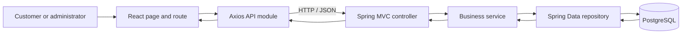
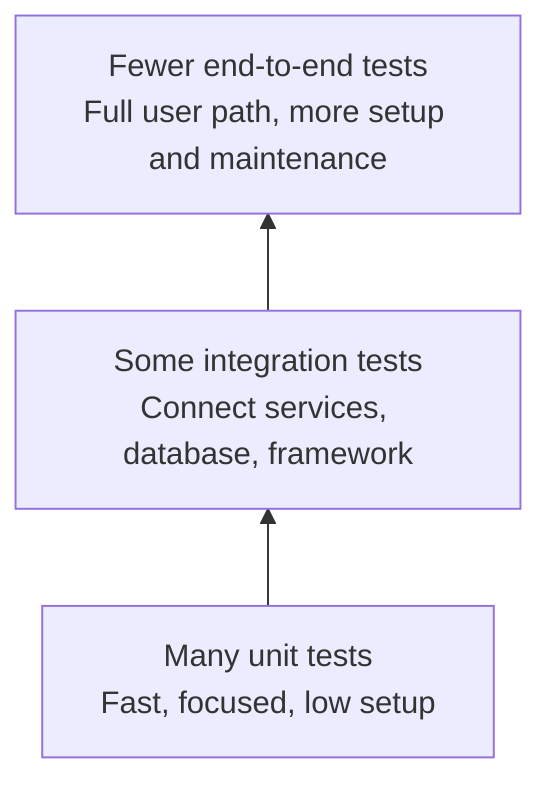

# 00 — SportHub codebase overview

This guide describes what is in the repository today, so future test examples can be based on real code. It is an orientation guide, not a claim that every planned application feature is implemented.

## 1. What the repository contains

SportHub has four main parts:

1. **Frontend** (`frontend/`) — a React and TypeScript web application built with Vite. It has pages and API client functions for customer and administrator workflows.
2. **Backend** (`backend/`) — a Java 21 / Spring Boot 3.4.5 Maven application. The current Java implementation is a small skeleton: it has application startup, a pricing rule class, and common error response handling, but not the controllers and persistence/business services needed to serve the frontend's booking and shop API.
3. **Database** (`database/`) — PostgreSQL 16 Compose configuration, eight Flyway SQL migrations and helper scripts. The migrations define tables and seed catalogue data.
4. **QA tools** (`qa/`) — a separate Maven project for TestNG, REST Assured and Selenium, plus Apache JMeter plan files.

The shared product contract is in [`docs/contracts/PROJECT_CONTRACT.md`](../contracts/PROJECT_CONTRACT.md). The API and data-model contract files next to it are currently headings only. Some older README statements say that the database migrations are placeholders; that no longer matches the checked-in `database/migrations/V1` through `V8`, which contain SQL. Treat the code and migrations as the evidence of current state.

## 2. Application architecture

### Intended request path

The intended web request path is:



- **React page/route** displays the screen, collects input and responds to user actions. `App.tsx` defines routes; `Pages.tsx` contains the page components.
- **Axios API module** builds HTTP requests to the backend. `api/client.ts` sets the base URL and attaches a saved bearer token. `api/index.ts` groups requests such as login, facility browsing, carts and checkout.
- **HTTP** is the request/response protocol between the browser and server. JSON is the data format used for most request and response bodies.
- **Controller** is the server's HTTP entry point. It would receive a request, validate its shape and call a service. There are currently no Spring MVC controllers in `backend/src/main/java`.
- **Service** owns application rules, such as deciding if a booking is available or recalculating a checkout total. The current relevant business class is `PricingService`; booking, cart, checkout and authentication services are absent.
- **Repository** reads and writes application records through Spring Data JPA. The dependency is present, but there are currently no repository interfaces or JPA entities in backend source.
- **PostgreSQL** stores the relational records. Flyway applies the SQL in `database/migrations/`. The database schema exists in SQL, but the backend currently has no matching Java entity/repository layer.

### What happens in the current code

The frontend is written as if the API routes exist. For example, `facilityApi.list()` calls `GET /facilities`, and checkout calls `POST /checkout`. The backend does not currently contain routes to handle those calls. Its Java request path therefore stops before the controller stage: there is no implemented business API to receive the frontend calls.

The backend's `PricingService` is currently a **pure Java class**: it classifies a customer by age on an appointment date and calculates a facility price. It does not query PostgreSQL. `GlobalExceptionHandler` describes how a future REST API can format validation and unexpected errors, but without controllers it does not create endpoints by itself.

The database migrations are more complete than the backend implementation. They define accounts/profiles, facilities/resources, products/inventory, discounts/coupons, carts, bookings, orders, payments and constraints. For example, V7 adds a partial unique index so one slot cannot have two confirmed bookings. A SQL constraint is a database-enforced rule; it can protect stored data even when multiple requests race, but it does not implement the booking API or the user-facing error response.

## 3. Important files

| File/Directory | Purpose | Why it matters for testing |
|---|---|---|
| [`frontend/src/App.tsx`](../../frontend/src/App.tsx) | Declares public, customer-protected and admin routes. | UI/system tests can check navigation and access guards. |
| [`frontend/src/pages/Pages.tsx`](../../frontend/src/pages/Pages.tsx) | Implements home, facility, product, cart, checkout, account and admin screens. | Main source for user-visible workflows and stable `data-testid` selectors. |
| [`frontend/src/api/client.ts`](../../frontend/src/api/client.ts) | Configures Axios, base URL, bearer token and 401 handling. | Frontend tests can verify request/error behavior; API tests exercise the server independently. |
| [`frontend/src/api/index.ts`](../../frontend/src/api/index.ts) | Groups API calls by feature (auth, facilities, products, cart, orders, admin). | Shows intended paths, HTTP methods and payload fields. |
| [`frontend/src/contexts/AuthContext.tsx`](../../frontend/src/contexts/AuthContext.tsx) | Manages current user and login/registration state in the browser. | Tests can check session state and how routes react to it. |
| [`frontend/src/routes/Guards.tsx`](../../frontend/src/routes/Guards.tsx) | Redirects unauthenticated and non-admin users away from protected routes. | Good candidate for component-level tests; this is client-side access control only. The server must also enforce authorization when implemented. |
| [`frontend/src/pages/Pages.test.tsx`](../../frontend/src/pages/Pages.test.tsx) | Vitest/React Testing Library tests for forms, page states, cart display and guards. | The existing frontend test suite and example test placement. API modules are mocked in these tests, so they do not prove the backend works. |
| [`frontend/package.json`](../../frontend/package.json) | Frontend scripts and dependencies. | Identifies Vitest, Testing Library, TypeScript and the commands available. |
| [`backend/src/main/java/com/sporthub/SportHubApplication.java`](../../backend/src/main/java/com/sporthub/SportHubApplication.java) | Spring Boot startup class. | Entry point when starting the server; it currently discovers very few application components. |
| [`backend/src/main/java/com/sporthub/pricing/PricingService.java`](../../backend/src/main/java/com/sporthub/pricing/PricingService.java) | Age classification and facility price calculation. | Presently the best real backend example for unit tests. |
| [`backend/src/main/java/com/sporthub/common/GlobalExceptionHandler.java`](../../backend/src/main/java/com/sporthub/common/GlobalExceptionHandler.java) | Maps validation and unexpected exceptions to a common error body. | Later API tests can verify HTTP error contracts after routes exist. |
| [`backend/src/test/java/com/sporthub/pricing/PricingServiceTest.java`](../../backend/src/test/java/com/sporthub/pricing/PricingServiceTest.java) | TestNG tests for age boundaries, rounding and invalid dates. | Existing backend unit test; demonstrates a test method, data provider and assertions. |
| [`backend/src/test/java/com/sporthub/common/GlobalExceptionHandlerTest.java`](../../backend/src/test/java/com/sporthub/common/GlobalExceptionHandlerTest.java) | TestNG/Mockito unit check for generic error response formatting. | Shows how a mock isolates the servlet request dependency. |
| [`backend/pom.xml`](../../backend/pom.xml) | Backend dependencies and Maven test configuration. | Includes TestNG, Mockito, Spring Test, Testcontainers, REST Assured and JaCoCo. Surefire uses `testng.xml`; Failsafe is configured for integration tests. |
| [`backend/src/main/resources/application.yml`](../../backend/src/main/resources/application.yml) | Backend port, database, Flyway, JPA, JWT and payment settings. | Shows runtime configuration and environment-variable names. |
| [`database/migrations/`](../../database/migrations/) | Ordered SQL schema and seed migrations V1–V8. | Real PostgreSQL integration tests should validate these schema rules and transaction behavior. |
| [`database/docker-compose.yml`](../../database/docker-compose.yml) | PostgreSQL 16 local database, by default on port 5432. | One way to create a local database matching the database README. |
| [`backend/compose.yaml`](../../backend/compose.yaml) | Alternate PostgreSQL 16 local database on host port 5433 with `sporthub` credentials. | This is the Compose file used by the backend README's startup command. Use one Compose database setup at a time. |
| [`qa/automation/src/test/java/com/sporthub/qa/api/PlatformApiTest.java`](../../qa/automation/src/test/java/com/sporthub/qa/api/PlatformApiTest.java) | REST Assured checks for public Actuator health status and Spring Security protection on the generated OpenAPI route. | API smoke/sanity examples against implemented routes. |
| [`qa/automation/src/test/java/com/sporthub/qa/base/DriverFactory.java`](../../qa/automation/src/test/java/com/sporthub/qa/base/DriverFactory.java) | Creates a Chrome WebDriver for browser automation. | Shared Selenium setup; current tests cover UI smoke/sanity, not complete business journeys. |
| [`qa/automation/src/test/java/com/sporthub/qa/ui/PublicUiSmokeTest.java`](../../qa/automation/src/test/java/com/sporthub/qa/ui/PublicUiSmokeTest.java) | Browser checks for login form requirements, under-age registration rejection, and customer admin-route redirect. | Selenium smoke/sanity examples of current React behavior; they do not prove the missing business APIs. |
| [`qa/performance/jmeter/`](../../qa/performance/jmeter/) | JMeter plan files for browsing, checkout, contention and product search. | Performance-test starting points; README describes them as placeholders pending runnable APIs and data setup. |
| [`.github/workflows/ci.yml`](../../.github/workflows/ci.yml) | GitHub Actions CI for backend, frontend and QA automation compilation. | Shows which checks run on pushes/pull requests and where reports are uploaded. |

## 4. Current test inventory and where future tests belong

| Test kind | Current location | Current state |
|---|---|---|
| Backend unit | `backend/src/test/java/com/sporthub/<feature>/` | TestNG pricing and shared error-response tests exist. Put isolated Java rule tests beside the feature package, e.g. `com.sporthub.booking` when that service exists. |
| Backend integration | [`PostgresApplicationIT.java`](../../backend/src/test/java/com/sporthub/integration/PostgresApplicationIT.java) | Spring TestContext, JDBC and Testcontainers exercise Flyway, PostgreSQL constraints/rollback, public health status and default protection on `/v3/api-docs`. |
| Frontend component | `frontend/src/**/*.test.tsx` | One Vitest test file covers basic forms/pages/guards. These tests mock API modules. |
| API / browser | `qa/automation/src/test/java/com/sporthub/qa/api/` and `.../ui/` | Two API checks and three Selenium checks exist for current operational/frontend behavior. Business API/UI journeys remain blocked. |
| Performance | `qa/performance/jmeter/*.jmx` | New health smoke/load plans are runnable; facility/product/checkout templates require the missing business routes. |

TestNG is already configured in both Maven projects. The backend uses Maven Surefire for unit tests and Failsafe for integration tests. The frontend uses Vitest and React Testing Library. The separate QA module has REST Assured, Selenium 4 and WebDriverManager dependencies. JMeter is an external application; it is not run by the Maven test lifecycle.

## 5. Major business workflows and current implementation boundary

These are the workflows represented by the frontend, product contract and database schema. “Frontend flow present” means screens/request construction exist; it does **not** mean a matching backend endpoint is implemented.

| Workflow | Frontend / database evidence | Backend status today |
|---|---|---|
| Register and log in | Auth forms in `Pages.tsx`; `authApi` in `api/index.ts`; `app_users` and `customer_profiles` in V1. | No auth controller, account service, repository, JWT filter or security configuration. |
| Browse sports and facilities | Facility pages; `facilityApi`; facility/resource tables in V2. | No facility controller/service/repository. |
| Choose a slot and add a booking to cart | Facility detail uses server-returned slots and profile selection; V5 contains slots and cart items. | No slot, profile or cart endpoints/services. A message in the UI says the slot is confirmed only at checkout; reservation logic is not implemented in Java. |
| Apply age or coupon discount | Cart UI renders server amounts; coupon form and V4 policies/coupons. `PricingService` implements age category/venue price logic. | No coupon/cart pricing service or checkout integration; only the isolated facility pricing class exists. |
| Checkout, orders and bookings | Checkout/order pages; V6 stores order, booking, payment and idempotency data. | No checkout/order/booking endpoints or transaction service. |
| Browse and buy products | Product and cart pages; V3 stock and V5 cart lines. | No product/inventory/cart services or endpoints. |
| Admin management | Admin route/pages and admin API calls; schema includes catalogue entities. | No role enforcement or admin endpoints in backend source. Frontend guards alone are not server authorization. |

## 6. How to run the application locally

These commands use the repository's checked-in configuration. They start the current components; they do not make the missing backend routes available.

### A. Start PostgreSQL

The backend README uses its own Compose file and maps PostgreSQL to host port **5433**:

```sh
docker compose -f backend/compose.yaml up -d
```

Run this from the repository root. It creates database/user `sporthub` with the local Compose password `sporthub`. Alternatively, the database guide has a separate Compose file on port 5432 and a `database/.env.example`; do not start both configurations unless you deliberately want two databases.

### B. Start Spring Boot

In a second terminal, run from the repository root:

```sh
cd backend
DATABASE_URL=jdbc:postgresql://localhost:5433/sporthub \
JWT_SIGNING_SECRET=MDEyMzQ1Njc4OWFiY2RlZjAxMjM0NTY3ODlhYmNkZWY= \
mvn spring-boot:run
```

Spring Security auto-configuration exposes the basic health status and protects `/v3/api-docs`. The backend has no project-specific authentication code yet.

The backend defaults to port `8080`; `application.yml` reads the database URL and JWT secret from environment variables and points Flyway at `../database/migrations` when launched from `backend/`. The example signing secret is for local development only. The SQL migrations are present and should be applied to a fresh database at startup. `spring.jpa.hibernate.ddl-auto` is `validate`, so Hibernate checks mappings rather than creating tables.

### C. Start React

In another terminal:

```sh
cd frontend
cp .env.example .env
npm install
npm run dev
```

Vite prints the local URL (configured by this project as `http://localhost:5173`). The checked-in `.env.example` points the API client at `http://localhost:8080/api/v1`. The pages load, but API-backed workflows will fail until matching backend routes are implemented.

### D. Run the existing tests

Backend unit tests (TestNG):

```sh
cd backend
mvn test
```

Frontend tests (Vitest):

```sh
cd frontend
npm test
```

The independent API/browser automation project is run from `qa/automation` with `mvn test`; it needs the backend and frontend running and Chrome installed. It checks public health, default security on the OpenAPI route and current frontend form/guard behavior. It does not check facility API behavior because the backend has no `/facilities` controller.

## 7. Testing concepts and the testing pyramid

**Software testing** means checking the software with examples and comparing what it did with what it was supposed to do. A test is useful when it gives evidence about a real requirement and fails when that requirement is broken.

Tests can look at different amounts of the system:

- **Unit test:** checks one small piece of code in isolation. In this repository, `PricingServiceTest` checks age classification and price calculation without a server or database.
- **Integration test:** checks that parts work together, such as Java, PostgreSQL migrations, constraints and transactions. `PostgresApplicationIT` now implements these schema-level checks; no business repository/service tests exist yet.
- **API test:** sends HTTP requests to an API and checks status, headers or response data. API describes how the test interacts with the application; it can be used at different test scopes. The current REST Assured tests call health and Springdoc paths that exist today; there is no business API endpoint yet.
- **System test:** checks the application as a whole against requirements, often through its public interfaces and real supporting services.
- **End-to-end (E2E) test:** follows a user journey across the interface and backend, for example register → select a court slot → checkout → see confirmation. No such browser test exists in the repo today.
- **Acceptance test:** checks whether a user/business requirement is met, such as “a confirmed slot cannot be booked a second time.” Acceptance describes the purpose/criteria and may be tested by a person or automated at several layers.

### The pyramid

The pyramid is a rule of thumb for balancing a suite, not a strict law. Small focused tests are generally quick and cheaper to diagnose. Tests that connect more real parts give broader confidence but usually need more setup and can fail for more reasons.



For SportHub, a sensible mix is many tests around rules such as age pricing; some PostgreSQL tests around booking uniqueness, inventory and transaction behavior; and a smaller set of browser journeys for the most important customer/admin flows. Current coverage includes two backend unit classes, one PostgreSQL/Spring integration class, one frontend test file, two external API checks and three browser checks. Business booking/shop coverage remains blocked by missing server-side feature code.

## 8. How to read the existing tests

Open [`PricingServiceTest.java`](../../backend/src/test/java/com/sporthub/pricing/PricingServiceTest.java). Its data provider supplies DOB/date pairs at the child/adult and adult/senior boundaries. Each `@Test` calls the real `PricingService` and an assertion compares the actual category or price with the expected one. That is a focused unit test because no Spring context, HTTP request or database is involved.

Open [`Pages.test.tsx`](../../frontend/src/pages/Pages.test.tsx). It renders React components with a test router and replaces API modules with controlled mock functions. This can check how a page behaves for an empty facility list or a rejected coupon call. Since the backend is mocked out, it cannot prove that a real HTTP endpoint or PostgreSQL query works.

Test locations as features grow:

- Pure Java business rule → `backend/src/test/java/com/sporthub/<feature>/...Test.java`.
- Spring/database collaboration → `backend/src/test/java/com/sporthub/integration/...IT.java`.
- React component behavior → near the component, as `*.test.tsx` under `frontend/src/`.
- Real HTTP contract → `qa/automation/src/test/java/com/sporthub/qa/api/`.
- Real browser user journey → `qa/automation/src/test/java/com/sporthub/qa/ui/` (with page objects in `.../pages/`).
- Load/concurrency profile → `qa/performance/jmeter/`.

## 9. A useful first exercise

In `PricingServiceTest.java`, find the test whose name includes `ageBoundaries`. Without changing code, write down:

1. One example input: date of birth and appointment date.
2. The expected customer classification.
3. Which assertion compares the actual answer with that expected answer.
4. Why this test does not need PostgreSQL.

When you are ready, tell me what you noticed or ask about any part of the architecture. We can then continue to the next learning phase.
