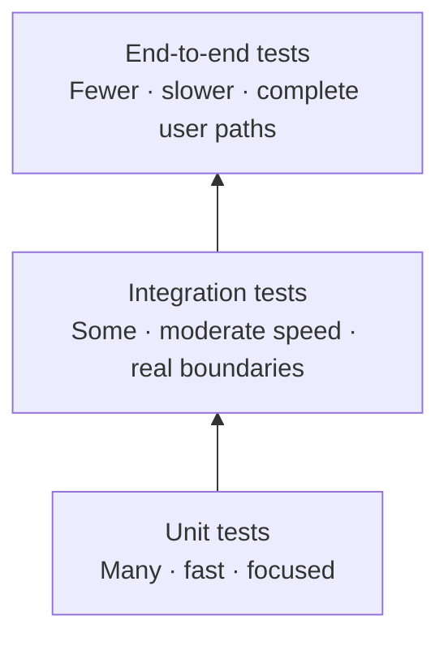

# 01 — Software testing fundamentals

This guide introduces the basic ideas behind software testing and connects each idea to SportHub's current code. You do not need to know testing terminology in advance.

## 1. What is software testing?

**Software testing** is checking software using carefully chosen examples, then comparing what actually happened with what should have happened. A test gives evidence that a particular behavior works for the examples tried. It cannot prove that a program has no bugs at all.

For example, SportHub's `PricingServiceTest` passes a birth date and an appointment date to `PricingService.classify`. It expects the result `CHILD` for someone who is 17 on the appointment date. If the method instead returns `ADULT`, the test reports a failure and points to a likely problem in the age rule.

### Why test software?

Testing helps a team:

- Find mistakes before users rely on the software.
- Check that business rules are applied consistently, such as not giving a child discount to an adult.
- Notice when a change breaks a behavior that used to work.
- Communicate what the application is expected to do.
- Make changes with better evidence and less guesswork.

Booking example: if the same one-capacity court slot is accidentally confirmed twice, both customers may arrive expecting to play. A meaningful test should check the rule at the level where the application enforces it. The current database migration V7 contains a uniqueness rule for confirmed bookings, and the integration test checks it with sequential inserts; there is not yet a backend booking API to exercise the full workflow.

### Bugs, defects and failures

These words are related, and people sometimes use them informally as synonyms:

- A **mistake** is a human action that introduces a problem, such as writing `age > 18` where the rule requires `age >= 18`.
- A **defect** (or **bug**) is a problem in a requirement, design, code, data or configuration. The age comparison could contain a defect.
- A **failure** is the visible incorrect behavior when a defect is encountered. If an 18-year-old is categorized as a child, that behavior is a failure.

A test failure does not automatically mean the application has a defect. The test itself, its data, or the environment can also be wrong; the debugging guide will cover how to distinguish these.

### Verification and validation

- **Verification** asks: “Did we build the software according to its specified design or rules?” A unit test checking that age 18 is classified as `ADULT` verifies the implemented boundary rule.
- **Validation** asks: “Does this software solve the user's real problem?” A customer trying to book a suitable court and finding the flow clear is evidence about whether the experience meets the need.

In short: verification checks conformance to a specification; validation checks usefulness for the intended user. Both matter. A technically correct booking rule is not enough if customers cannot find or understand available slots.

### Manual and automated testing

- **Manual testing** means a person follows steps and observes the result. For example, open the site, choose a facility, select an available slot, and see what the page displays.
- **Automated testing** means a program performs steps and checks results. The repository has a Vitest test that renders the facilities page with a mocked API response and checks that the empty state appears.

Automation is useful for repeatable checks, especially after code changes. It still needs thoughtful test design, and it does not replace human judgment about usability or exploratory behavior.

### Functional and non-functional testing

- **Functional testing** checks what the system does: its features and rules. Examples: a child receives the configured facility discount; a login form requires an email; an occupied slot is rejected.
- **Non-functional testing** checks qualities such as speed, accessibility, security, reliability or usability. Examples: facilities load within an agreed time under a defined workload; an ordinary customer cannot access administrator data.

The QA folder contains JMeter plans intended for performance checks. Those plans are starting points, not evidence of measured capacity. A speed target only means something when the environment and workload are defined.

### Positive and negative testing

- A **positive test** gives valid input and checks the expected success. Example: a valid birth date and appointment date produce an age category.
- A **negative test** gives invalid or disallowed input and checks safe rejection. Example: the appointment date is earlier than the birth date; `PricingService.classify` should throw `IllegalArgumentException`.

Negative tests are not tests that should themselves fail. A negative test passes when the application rejects the bad input in the expected way.

### Regression testing

**Regression testing** reruns checks to see whether a change has broken behavior that previously worked. Suppose someone changes how age is calculated. Rerunning the age-boundary tests helps catch an accidental change to the 18-year or 60-year thresholds.

Automated tests are often used for regression checks because they can be repeated consistently. A regression suite is the selected set of tests that a team reruns after changes.

Two useful quick-check terms are:

- A **smoke test** is a shallow check that the most basic system capability is alive. SportHub's Actuator health check is a smoke test; it does not prove booking works.
- A **sanity test** is a focused check that a particular changed area or key assumption still behaves sensibly. The OpenAPI access check is a sanity check for the current server's default protection behavior.

Teams sometimes use these terms differently. The important part is to state the test's scope and what its pass does—and does not—prove.

## 2. The building blocks of a test

These terms describe different levels of planning and detail:

- **Test scenario**: a broad behavior or situation to check. Example: “A customer can book an available future court slot.”
- **Test case**: specific preconditions, input, steps and expected result. Example: “Given an active slot tomorrow and a customer profile, add that slot to the cart; expect the cart to show one booking item.”
- **Test suite**: a group of related test cases run together, such as the backend TestNG suite selected by `backend/src/test/resources/testng.xml`.
- **Test plan**: a broader plan that says what will be tested, how, by whom or with what environment, and what is in or out of scope. A plan can cover multiple suites and test types.
- **Precondition**: what must be true before the test begins. Example: a test profile and future slot exist.
- **Test data**: the values and records used by a test. Example: DOB `2008-11-02` and appointment date `2026-11-01`.
- **Expected result**: what the test says should happen. Example: `CHILD`.
- **Actual result**: what the code or application did. The test compares this with the expected result.
- **Postcondition**: what should be true after the test. An integration test might clean up a created booking or roll back its database transaction.

### Assertions and coverage

An **assertion** is a check that compares an actual value or condition with an expected one. In the repository's TestNG test:

```java
assertEquals(
    pricing.classify(LocalDate.parse(dob), LocalDate.parse(date)),
    expected
);
```

The method call produces the actual classification. `expected` is the value supplied by the test data. `assertEquals` makes the test pass if they match and fail if they differ.

**Test coverage** describes which code or requirements were exercised by a set of tests. For example, line coverage estimates how many executable code lines ran. High coverage can reveal untested code, but it does not prove the assertions are meaningful or that every important behavior is correct. A test that runs a price calculation without checking its result adds execution coverage but little confidence.

## 3. Testing levels and approaches

Testing levels describe how much of the system is included in a check. They are useful categories, not rigid boxes. A single test can have characteristics of more than one level.

### 3.1 Unit testing

- **Definition:** Check a small piece of code (a unit) by itself, usually a method or class.
- **Purpose:** Find mistakes in local logic quickly and precisely.
- **Scope:** Narrow. Inputs go to one unit; its return value, state change or exception is checked.
- **What is tested:** The rule itself, such as age classification or money rounding.
- **Dependencies:** Usually no database, server or browser. Other collaborators may be replaced with mocks, though a simple pure class may need no mock.
- **Typical tools:** TestNG or JUnit for Java; Vitest and React Testing Library for frontend components.
- **SportHub example:** `PricingServiceTest.classifiesOnAppointmentDate` calls the real `PricingService.classify` method with dates. It does not start Spring or contact PostgreSQL.
- **Example case:** Given DOB `2008-11-02` and appointment date `2026-11-01`, expect `CHILD` because the person has not yet reached their 18th birthday.
- **Advantages:** Fast, focused, and failures often identify the exact rule that needs attention.
- **Limitations:** It cannot show that a controller, database mapping, network request or whole user journey is wired correctly.

The word **unit** does not always mean exactly one method. The practical idea is to keep the test focused and isolate external collaborators where needed.

### 3.2 Integration testing

- **Definition:** Check that multiple parts work together across a boundary between components.
- **Purpose:** Find mismatches in wiring, data mapping, SQL, framework configuration or transactions.
- **Scope:** Broader than a unit test, but usually focused on one collaboration rather than a complete user journey.
- **What is tested:** For example, a Spring service saves a booking through a repository and PostgreSQL enforces the confirmed-slot uniqueness rule.
- **Dependencies:** Some dependencies are real. A database integration test should use a database. Other unrelated services may still be mocked.
- **Typical tools:** Spring Boot Test / Spring TestContext, TestNG or JUnit, Testcontainers for disposable PostgreSQL.
- **SportHub example:** A future integration test could save and retrieve a profile using a Spring Data repository against PostgreSQL initialized by the Flyway migrations. No such backend integration test currently exists.
- **Example case:** Insert one confirmed booking for a slot; attempt a second insert for the same slot; expect PostgreSQL to reject it because of the V7 unique partial index. This proves the database constraint, not an API conflict response.
- **Advantages:** Catches errors that isolated unit tests cannot, including schema and configuration mismatches.
- **Limitations:** Slower and more complex to set up. Failures may involve the application, database, migration or test environment, so diagnosis can take longer.

**Integration** is about components collaborating. It does not necessarily mean “connect every part of the production system.” A useful integration test chooses the real boundary it wants to check.

### 3.3 API testing

- **Definition:** Send requests through an API and check the observable contract: status code, headers, response body and side effects where appropriate.
- **Purpose:** Check how a caller communicates with a service, including success, error, validation and access behavior.
- **Scope:** It is an interaction approach, not necessarily its own testing level. An API test can be a system-level check against a deployed application, or a more focused integration test against a local Spring application.
- **What is tested:** For a working SportHub API, `GET /facilities` might return HTTP 200 and a JSON list of facilities.
- **Dependencies:** HTTP server and route; often service and database too, depending on the test setup.
- **Typical tools:** curl or Postman for manual requests; REST Assured for automated Java tests.
- **SportHub example:** `PlatformApiTest` sends REST Assured requests to the implemented health route and the Springdoc route protected by default security. It does not cover planned business APIs; those remain blocked until server routes exist.
- **Example case:** Send a valid `GET /facilities`; expect HTTP 200, JSON content type, and a body containing a facility identifier and name. The response field expectations must be based on an implemented API contract.
- **Advantages:** Tests a stable service boundary without requiring a real browser; usually faster and easier to diagnose than a browser journey.
- **Limitations:** It does not prove the frontend renders the response correctly or that a user can complete the journey. A test can also be wrong if it assumes an undocumented response format.

HTTP status codes communicate broad outcomes. For example, `200` usually means a successful read, `201` a resource was created, `400` a request was invalid, `401` authentication is missing/invalid, `403` the caller lacks permission, and `404` a resource or route was not found. Exact choices should follow the actual API contract.

### 3.4 System testing

- **Definition:** Check the application as a whole against its specified requirements, using its external interfaces.
- **Purpose:** Find problems that only appear when complete features and configured services work together.
- **Scope:** A feature or application-level behavior, often with most relevant dependencies running.
- **What is tested:** A real customer journey or system capability, such as a valid login leading to a customer-only page.
- **Dependencies:** Usually a running frontend/backend and required services. The database may be real or controlled test infrastructure.
- **Typical tools:** REST Assured for system/API paths; Selenium for browser paths; setup scripts or fixtures for test data.
- **SportHub example:** After the booking API exists, check that selecting a real future slot and profile creates a cart entry reflected by a subsequent cart request.
- **Example case:** Start the test environment with a known customer and open slot; add the booking through the user interface; verify the cart and booking confirmation show the selected slot.
- **Advantages:** Gives confidence in combined behavior and configuration close to how the product is used.
- **Limitations:** Broader failures are harder to localize and can depend on setup, data or service availability. It is usually slower than a unit test.

System testing is about the scope of the system under test. It may use API calls, browser actions or a mix of interfaces.

### 3.5 End-to-end testing

- **Definition:** Follow a complete user-visible path through the application from an entry point to an outcome.
- **Purpose:** Confirm that key parts work together from the user's perspective.
- **Scope:** A cross-feature journey, often browser → frontend → HTTP API → backend → database.
- **What is tested:** The visible outcome and important interactions across the full path.
- **Dependencies:** Typically a browser, frontend, backend, database, authentication and controlled data.
- **Typical tools:** Selenium WebDriver for browser automation; REST Assured may prepare or verify data.
- **SportHub example:** A future E2E test could sign in, browse facilities, choose a future slot, add it to the cart, check out and verify an order confirmation. It cannot currently complete because the backend workflow is not implemented.
- **Example case:** Given an active customer, a dependent profile and an available future slot, use the browser to add the slot and complete checkout; expect an order confirmation and one confirmed booking in the system.
- **Advantages:** Exercises a realistic path and can expose broken connections between layers.
- **Limitations:** More setup, slower execution, and more fragile to UI or environment changes. One failed journey may have many possible causes.

**System test** and **end-to-end test** are sometimes used interchangeably. A useful distinction is that system testing refers to checking the system against its requirements, while E2E emphasizes following a complete user journey across components. An E2E test is one way to perform system-level testing; not every system test needs to be a long browser flow.

### 3.6 Acceptance testing

- **Definition:** Check whether the product meets agreed user or business acceptance criteria.
- **Purpose:** Decide whether a feature is acceptable for its intended use or release.
- **Scope:** A requirement, feature or complete release, expressed in user/business terms.
- **What is tested:** Outcomes that matter to a user or stakeholder, not an internal class structure.
- **Dependencies:** May be a person checking the feature, an automated API/UI suite, or both.
- **Typical tools:** Acceptance criteria, checklists, exploratory sessions, automated tests with tools already used by the team.
- **SportHub example:** “A customer cannot complete checkout for a slot that another customer has already confirmed.” A business owner can accept this behavior by reviewing a demonstrated scenario; automated integration and E2E tests can provide repeatable supporting evidence.
- **Example case:** Given two customers and one available slot, the first checkout succeeds; the second is rejected with a clear message; only one confirmed booking exists.
- **Advantages:** Connects testing to business value and clarifies what “done” means.
- **Limitations:** Acceptance criteria can be vague, and passing acceptance checks does not guarantee every technical risk is covered.

Acceptance testing is a purpose/decision. It can use tests at different technical levels; it is not defined by a specific tool.

### Quick comparison

| Category | Main question | Example in SportHub | Current repository evidence |
|---|---|---|---|
| Unit | Does this small rule behave correctly? | Does age classification return `CHILD` at age 17? | Yes: TestNG `PricingServiceTest`. |
| Integration | Do these components work together? | Does PostgreSQL reject a duplicate confirmed slot? | Implemented schema constraint; sequential insert test exists, service/API behavior does not. |
| API | Does an HTTP caller receive the expected contract? | Does `GET /facilities` return a documented facility list? | One REST Assured check exists, but backend route is absent. |
| System | Does the application meet a feature requirement as a whole? | Does cart behavior reflect a selected booking? | Not implemented across backend currently. |
| E2E | Can a user complete a full journey? | Sign in through order confirmation in browser. | No Selenium journey tests; backend flow is absent. |
| Acceptance | Does the result satisfy the agreed user/business rule? | A slot is confirmed only once. | Requirement is in the project contract/schema, but feature needs implementation. |

**API testing is not automatically a separate level.** An HTTP request can exercise only a controller with mocked service collaborators (narrow integration test), or it can go through a live system with PostgreSQL (system-level API test). The term “API test” tells you how the test communicates, not exactly how much of the application it includes.

## 4. The testing pyramid

The testing pyramid is a common guide for choosing a balanced mix of automated tests:



- **Number:** Teams often have many unit tests, fewer integration tests and a small number of end-to-end tests. This is a useful starting balance, not a fixed required ratio.
- **Speed:** Unit tests avoid starting external systems, so they are generally fastest. Integration tests start frameworks or databases. E2E tests may start browsers and multiple services, so they usually take longest.
- **Scope:** Unit tests check small rules. Integration tests cross selected component boundaries. E2E tests cross many boundaries and validate a user journey.
- **Maintenance cost:** A unit test often changes only when its rule changes. Integration tests need reliable infrastructure and test data. E2E tests also depend on browser pages and selectors, so user-interface changes can require updates.
- **Failure diagnosis:** A unit-test failure usually points to a small area. A broad E2E failure can come from the browser, frontend, API, server, database, network or test data.

For SportHub, the pyramid suggests putting many fast checks around deterministic rules like age thresholds and money rounding; a smaller set of PostgreSQL tests around mappings, constraints and checkout transactions; and a handful of high-value browser journeys. API checks fit at different points depending on whether they isolate one server boundary or exercise the live system.

## 5. Beginner glossary

| Term | Plain-English meaning | SportHub example |
|---|---|---|
| Actual result | What happened when the test ran. | `PricingService` returned `CHILD`. |
| Assertion | A programmed comparison against an expected result. | `assertEquals(actual, expected)`. |
| Automation | Using software to repeat steps and check results. | Vitest renders a page and checks its empty state. |
| Boundary value | A value at or just beside a rule's edge. | The day someone turns 18, or the day before. |
| Defect / bug | A flaw in code, data, design or requirements. | Age 18 incorrectly receives the child category. |
| Expected result | What the test says should happen. | A 17-year-old on appointment day is `CHILD`. |
| Failure | Incorrect behavior observed when software runs. | A child is charged the adult price. |
| Functional test | A check of a feature or business rule. | An expired coupon is rejected. |
| Integration | Components working together across an interface. | A Spring service writes a booking through JPA to PostgreSQL. |
| Mock | A controlled substitute for a dependency in a test. | A page test replaces `facilityApi.list` with a chosen response. |
| Non-functional test | A check of a quality such as speed or security. | Measure facility-list response latency under a defined load. |
| Positive test | A valid use case expected to succeed. | Classify a valid DOB and appointment date. |
| Negative test | An invalid or disallowed use case expected to be rejected. | Reject a birth date later than the appointment date. |
| Regression | A problem caused by a later change that breaks prior behavior. | A pricing edit changes the 60-year eligibility boundary. |
| Sanity test | A narrow, quick check that a changed area behaves plausibly. | Check that an unauthenticated request to the generated OpenAPI route remains protected. |
| Smoke test | A shallow check that the most basic system path is alive. | Check `/actuator/health` returns `UP`. |
| Requirement | A statement of behavior or quality the product must meet. | A confirmed slot cannot have a second active booking. |
| Test case | Specific setup, steps, inputs and expected outcome. | Try to book an already confirmed slot and expect rejection. |
| Test coverage | A measure of code or requirements exercised by tests. | JaCoCo reports backend code execution coverage. |
| Test data | The values/records used by a test. | Appointment date and participant DOB. |
| Test plan | A document describing test scope, approach and execution. | A plan for validating booking, checkout and admin flows. |
| Test scenario | A high-level situation to test. | A customer checks out with a valid coupon. |
| Test suite | A set of tests grouped and run together. | Backend TestNG unit suite. |
| Unit | A small piece of code checked in isolation. | `PricingService.classify`. |
| Validation | Checking that the product meets a real user need. | Confirm the booking journey is understandable and usable. |
| Verification | Checking that implementation matches a stated rule/design. | Confirm age 18 is treated as `ADULT`. |

## 6. Check your understanding

Use the example from `PricingServiceTest`:

```java
{"2008-11-02", "2026-11-01", PricingService.Classification.CHILD}
```

The expected result is `CHILD` because the appointment occurs one day before the person's 18th birthday. The assertion invokes the real Java method and compares its result to the expected classification. This is a unit test: the rule is local to a Java class, so no database is needed.

Try these questions before moving on:

1. If the same check called a real Spring service and saved a booking to PostgreSQL, what would make it an integration test?
2. If a test used HTTP `GET /facilities`, what kind of test interaction would that be, and why does that alone not tell you its testing level?
3. Why might a team have many unit tests but fewer browser E2E tests?

The next phase is unit testing with TestNG. We will inspect the current pricing code and test class in detail before adding or changing tests.
