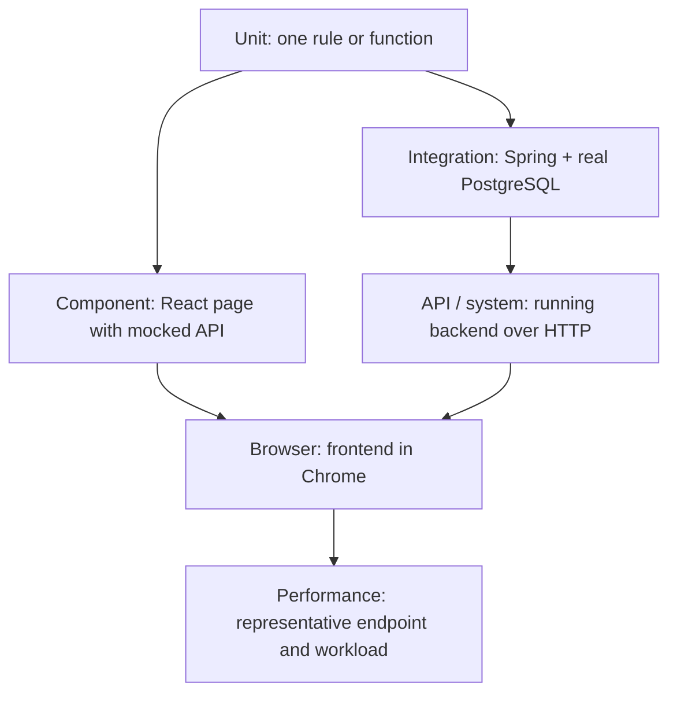

# Quality Engineering Documentation and Testability Plan

**Status:** proposed implementation roadmap  
**Audience:** agents preparing learning material, test cases, and QA runbooks for SportHub  
**Scope:** make the existing test strategy understandable to a beginner and make its coverage, evidence, limitations, and next steps easy to verify.

## Purpose

This plan directs future contributors to explain how a change moves through checks at different scopes: a small rule test, component tests, database/application integration, API checks, browser workflows, and performance checks. It is a learning sequence, not a claim that all layers are one automatic serial pipeline.

Use actual repository code in every lesson. A test name or a feature described in a product overview does not prove that the feature exists. Label statements as **Confirmed** (code or execution evidence), **Inferred** (strongly implied by code), **Planned** (in a product or requirements document only), **Blocked** (cannot be tested because an implementation or prerequisite is absent), or **Unknown** (evidence is insufficient). Date execution evidence and never describe a test as passing because it compiles.

## Repository findings that this work must respect

- The learning sequence already exists in [`README.md`](README.md) and its [index](README.md); the lesson files range from [codebase overview](00-codebase-overview.md) to [learn-by-doing](11-learn-by-doing.md). Audit and improve these instead of creating a second curriculum.
- Several operational pages are placeholders: [`docs/qa/test-plan.md`](../qa/test-plan.md), [`test-cases.md`](../qa/test-cases.md), [`test-data.md`](../qa/test-data.md), and [`traceability-matrix.md`](../qa/traceability-matrix.md) currently contain headings only. The two requirements files are also placeholders: [`functional-requirements.md`](../requirements/functional-requirements.md) and [`business-rules.md`](../requirements/business-rules.md).
- The backend has implemented pricing and shared error-response code, but no Java business controllers/services for the planned booking, product, cart, checkout, or persisted-account flows. See [backend Java source tree](../../backend/src/main/java/com/sporthub/) and the [API implementation status](../API_IMPLEMENTATION.md). Do not write production-level tests for imagined APIs.
- The current test assets are [pricing and error unit tests](../../backend/src/test/java/com/sporthub/), [PostgreSQL/Spring integration tests](../../backend/src/test/java/com/sporthub/integration/PostgresApplicationIT.java), [React page tests](../../frontend/src/pages/Pages.test.tsx), [REST Assured tests](../../qa/automation/src/test/java/com/sporthub/qa/api/PlatformApiTest.java), [Selenium tests](../../qa/automation/src/test/java/com/sporthub/qa/ui/PublicUiSmokeTest.java), and seven [JMeter plans](../../qa/performance/jmeter/).
- Recent local verification on 2026-11-05 passed 13 frontend tests, 12 backend unit tests, 6 backend integration tests, and 5 API/Selenium automation tests. The two health JMeter plans returned HTTP 200 for 1 and 25 samples. The five feature JMeter plans returned HTTP 401 for all 10 samples each. These are a dated observation, not a permanent status; rerun and refresh the execution record when the suites change.

## How the test layers fit together

Teach the learner to ask: “What is the smallest realistic boundary that can catch this kind of defect?” A test layer is about scope and dependencies, not just which tool runs it.

The normal learning/debugging order is from the narrow, fast checks to broader checks. The CI layout is different: the [CI workflow](../../.github/workflows/ci.yml) runs backend, frontend, and QA automation as separate jobs that can run in parallel. The nightly workflow adds an API regression job and a small JMeter health workload. Explain both the learning order and the actual pipeline; do not present the CI jobs as a guaranteed serial chain.

### Current evidence by layer

| Layer | Current example and code link | What the test can establish | Important limit |
|---|---|---|---|
| Backend unit | [`PricingService.classify` and `facilityPrice`](../../backend/src/main/java/com/sporthub/pricing/PricingService.java#L18-L40); [`PricingServiceTest`](../../backend/src/test/java/com/sporthub/pricing/PricingServiceTest.java#L16-L90) | Age boundaries, discount arithmetic, rounding, invalid inputs | No database, HTTP, or other Spring components are involved. |
| Error-handling unit | [`GlobalExceptionHandler`](../../backend/src/main/java/com/sporthub/common/GlobalExceptionHandler.java#L14-L37); [`GlobalExceptionHandlerTest`](../../backend/src/test/java/com/sporthub/common/GlobalExceptionHandlerTest.java#L13-L31) | Generic unexpected-error response fields and suppression of internal detail | Directly calls the handler; does not prove Spring routes all HTTP exceptions through it. |
| Frontend component/page | [`Pages.test.tsx`](../../frontend/src/pages/Pages.test.tsx); [page components and interactions](../../frontend/src/pages/Pages.tsx); [route guards](../../frontend/src/routes/Guards.tsx#L1-L3) | Rendered UI states, user interactions, client-side validation and behavior with mocked APIs | Mocked API responses do not prove the real backend accepts the request or persists the result. |
| Database/application integration | [`PostgresApplicationIT`](../../backend/src/test/java/com/sporthub/integration/PostgresApplicationIT.java#L32-L151) | Real PostgreSQL migrations, seed data, constraints, transaction rollback, and the current HTTP health/security routes | Direct JDBC inserts are not tests of a booking service. The duplicate-booking test proves a database constraint rejects a second confirmed row, not that an API returns a specific conflict response. |
| API smoke/sanity | [`PlatformApiTest`](../../qa/automation/src/test/java/com/sporthub/qa/api/PlatformApiTest.java#L12-L30) | Current health response and that Springdoc is protected | Only two endpoints are covered; there are no implemented business API journeys yet. |
| Browser smoke/sanity | [`PublicUiSmokeTest`](../../qa/automation/src/test/java/com/sporthub/qa/ui/PublicUiSmokeTest.java#L21-L78), [driver setup](../../qa/automation/src/test/java/com/sporthub/qa/base/DriverFactory.java#L1-L17), [page objects](../../qa/automation/src/test/java/com/sporthub/qa/pages/) | Chrome can render the frontend and the selected local UI behavior works | It is not a full purchase or booking journey. |
| Performance | [`health-smoke.jmx`](../../qa/performance/jmeter/health-smoke.jmx) and [`health-load-test.jmx`](../../qa/performance/jmeter/health-load-test.jmx) | Reachability and a small workload against `/actuator/health` | It does not measure booking, checkout, or production capacity. |

## Documentation rules for every workstream

1. **Beginner first:** define an unfamiliar term in ordinary words, then name the technical term. For example: “A mock is a pretend dependency that returns test-controlled answers (a test double).”
2. **Teach intuition:** state the risk/bug the test is meant to catch, why this boundary is appropriate, and why an adjacent layer would or would not help.
3. **Use Arrange–Act–Assert:** identify setup and data, the action, and each assertion. Say exactly what an assertion proves and what it cannot prove.
4. **Link to source:** use repository-relative Markdown links with line anchors where practical, such as [`facilityPrice` lines 28–39](../../backend/src/main/java/com/sporthub/pricing/PricingService.java#L28-L39). Link to the test and production behavior together. Do not use machine-specific `file:///home/...` URLs.
5. **Explain dependencies:** name which parts are real and which are mocked, and why. Explain setup/teardown annotations in the context of the actual TestNG, Spring, Vitest, Selenium, or JMeter configuration.
6. **Keep fact and intention separate:** a schema constraint is not an implemented API rule; a frontend mock is not a database test; a test plan is not proof that an endpoint exists.
7. **Avoid duplicate source-of-truth docs:** maintain the learning lessons under `docs/quality-engineering/`, operational QA references under `docs/qa/`, case catalogues under `docs/quality-engineering/test-cases/`, and a single traceability matrix. Add a small `docs/README.md` index linking to those sources and reading order.
8. **Comments should explain non-obvious purpose or risk.** Do not comment every line or restate syntax. If a file is too compressed to teach from, propose a behavior-preserving readability change separately and keep the diff reviewable.

## Implementation work plan

Work should be delivered in the order below. Independent contributors may take the named workstreams after Phase 0 has established the shared facts. Keep ownership of each document explicit so parallel edits do not create competing versions.

### Phase 0 — Establish the source of truth

**Owner:** reconnaissance/editorial agent. **No application changes.**

- Audit the current syllabus and operational docs. Record which pages are useful, stale, placeholders, or duplicate.
- Verify actual test classes/methods, build commands, environment prerequisites, workflow triggers, routes, migrations, and JMeter plans from source.
- Correct specific stale claims already visible in docs: integration test method counts; the actual shape of backend code; any claim that Selenium/API checks cover unimplemented business workflows; the runbook link in the root README (`doc/` versus `docs/`).
- Separate “implemented today” from “product intent” using the labels above. Treat the README and schema as clues, not a substitute for API/behavior requirements.
- Deliver an evidence-backed change list before broad documentation rewrites.

**Acceptance:** each reported behavior has a source link or is marked unknown; no feature described as implemented lacks production-code evidence.

### Phase 1 — Make the learning route and execution flow clear

**Owner:** curriculum agent. **Primary files:** `docs/README.md`, `docs/quality-engineering/README.md`, `docs/quality-engineering/00-codebase-overview.md`, `docs/quality-engineering/08-cicd.md`, and `docs/quality-engineering/11-learn-by-doing.md`.

- Add the missing top-level `docs/README.md` with a beginner reading order and clear links to the syllabus, requirements, case catalogue, and runbooks.
- Explain the test workflow using the actual entry points: backend `mvn test` (Surefire/unit) and `mvn verify` (also Failsafe/integration), frontend `npm test` and `npm run build`, QA automation `mvn test`, and the JMeter command.
- Map those commands to [backend Maven configuration](../../backend/pom.xml#L27-L40), [unit suite XML](../../backend/src/test/resources/testng.xml), [integration suite XML](../../backend/src/test/resources/testng-it.xml), [automation Maven configuration](../../qa/automation/pom.xml#L3-L19), [frontend scripts](../../frontend/package.json#L1-L9), and [GitHub Actions](../../.github/workflows/ci.yml).
- Explain local prerequisites and startup order: Docker/PostgreSQL, backend, frontend, then browser/API automation. Explain what remains running and how to stop it without deleting database volumes.
- Include a simple pipeline diagram and a second explanation of why CI jobs are parallel. Describe the nightly JMeter check as a small health check, not a product performance certification.

**Acceptance:** a beginner can choose a command for one layer, start its prerequisites, find its report, and tell what that run did not cover.

### Phase 2 — Walk through every existing test

**Owner:** existing-test-explanation agent. **Primary files:** `docs/quality-engineering/02-unit-testing-testng.md` through `06-performance-testing-jmeter.md`, plus `docs/qa/automation-framework.md` and `docs/qa/performance-testing.md`.

For every current test class, test method, and JMeter plan, write a short walkthrough containing:

- Production behavior under test and links to the method/component/route it exercises.
- Business risk or requirement, classified as confirmed or inferred.
- Arrange / Act / Assert, including test data and the meaning of each assertion.
- Real versus mocked dependencies, execution command, and expected result.
- Coverage and explicit non-coverage; likely causes when it fails.

Specific walkthrough anchors:

- [`ageBoundaries` data provider and pricing examples](../../backend/src/test/java/com/sporthub/pricing/PricingServiceTest.java#L16-L90) alongside [the pricing implementation](../../backend/src/main/java/com/sporthub/pricing/PricingService.java#L18-L40).
- [Error response test](../../backend/src/test/java/com/sporthub/common/GlobalExceptionHandlerTest.java#L17-L30) alongside [handler mappings](../../backend/src/main/java/com/sporthub/common/GlobalExceptionHandler.java#L14-L37).
- [PostgreSQL integration lifecycle and assertions](../../backend/src/test/java/com/sporthub/integration/PostgresApplicationIT.java#L32-L151), including `@SpringBootTest`, `@DynamicPropertySource`, `@LocalServerPort`, `@Transactional`, and `@AfterSuite`.
- [React/Vitest setup](../../frontend/vite.config.ts), [test setup](../../frontend/src/testSetup.ts), and the test cases in [`Pages.test.tsx`](../../frontend/src/pages/Pages.test.tsx). Explain mocked APIs versus a live server.
- [REST Assured tests](../../qa/automation/src/test/java/com/sporthub/qa/api/PlatformApiTest.java#L12-L30), [Selenium setup and teardown](../../qa/automation/src/test/java/com/sporthub/qa/ui/PublicUiSmokeTest.java#L21-L78), and [page-object locators](../../qa/automation/src/test/java/com/sporthub/qa/pages/).
- Each of the seven `.jmx` plans: requests, method, path, user/thread defaults, ramp/loop behavior, data, auth header, assertion, and actual supported status.

**Acceptance:** every current test has an explanation linked to both its test source and the production behavior (or a clear note that no production implementation exists). Avoid asserting that a passing check proves more than its boundary.

### Phase 3 — Build useful requirement-based test cases and traceability

**Owner:** test-design/catalogue agent. **Primary files:** `docs/quality-engineering/test-cases/`, `docs/quality-engineering/requirements-to-tests.md`, `docs/qa/test-cases.md`, `docs/qa/test-data.md`, `docs/qa/traceability-matrix.md`, and the empty requirement documents.

- Choose one canonical home: keep detailed beginner-oriented cases in `docs/quality-engineering/test-cases/`; make `docs/qa/` pages concise links/runbooks or merge their unique information. Do not maintain two competing case lists.
- For implemented behavior, create test cases with ID, goal, preconditions, setup/data, steps, expected result, test layer, automation link/status, and the specific risk addressed.
- Include appropriate equivalence partitions, boundaries, invalid data, authorization states, duplicates, and timing/concurrency scenarios. Explain why each case is useful; do not make a checklist without rationale.
- Build traceability from an identified requirement/business rule to case IDs and code/tests. Mark missing or speculative requirements as `needs confirmation`, and missing implementation as `blocked`; do not invent a contract to fill a blank page.
- Keep high-risk future scenarios (booking collision, inventory race, coupon eligibility/expiry, checkout idempotency) clearly labeled as planned until a matching service/API is implemented.

**Acceptance:** every executable case maps to an observable implementation and a command/test; every planned case states what API/service or requirement clarification it awaits; the matrix has no unsupported “covered” claims.

### Phase 4 — Teach testing design through code that exists

**Owner:** test-methodology agent. **Primary file:** `docs/quality-engineering/07-test-design.md` and related case catalogue pages.

- Teach equivalence classes, boundary analysis, decision tables, state transitions, negative testing, risk-based prioritization, test data, and traceability using SportHub examples.
- Start with real values and rules in [`PricingService`](../../backend/src/main/java/com/sporthub/pricing/PricingService.java#L18-L39), such as ages around 18 and 60 and money rounding around a half-cent. Explain the test setup in [the TestNG provider](../../backend/src/test/java/com/sporthub/pricing/PricingServiceTest.java#L16-L29).
- Use frontend behavior as a second real example: loading, error, empty, and populated states in [page components](../../frontend/src/pages/Pages.tsx) and their mocked results in [`Pages.test.tsx`](../../frontend/src/pages/Pages.test.tsx).
- Use schema constraints in [migration V7](../../database/migrations/V7__create_indexes_and_integrity_constraints.sql) and [the database integration test](../../backend/src/test/java/com/sporthub/integration/PostgresApplicationIT.java#L107-L129) to explain why a database-level race guard deserves a real-PostgreSQL check.
- Clearly distinguish a confirmed current rule from a future example (for example, double-booking is protected by a schema index, but there is not yet a booking API workflow to test end-to-end).

**Acceptance:** each method is taught with a real code example, an intuition/risk, at least one good case, and an explanation of the layer that can observe it.

### Phase 5 — Improve code explainability and test readability deliberately

**Owner:** source-explainability agent, coordinated with test owners. **Primary files:** current production and test files, plus a new/updated `docs/quality-engineering/02-code-explainability.md` if the syllabus does not already cover the need.

- Add concise class/method documentation only where it explains purpose, inputs, outputs, business assumptions, side effects, or an unintuitive decision.
- Prioritize `PricingService.classify`/`facilityPrice`, global error formatting, `useLoad`, auth persistence and guards, plus test fixture/lifecycle setup. Link the docs to the exact source lines.
- The React page/test files are densely compressed. First propose and review a behavior-preserving formatting change if readability blocks explanation; do not combine a large refactor with new test behavior.
- In tests, name the expected behavior in the method and use local variable names that clarify setup/action/result. Comments should explain why unusual test data or setup is needed, not narrate each statement.
- Add or extend tests only after describing the existing production method and the expected behavior. Use current frameworks (TestNG, Vitest, Selenium, JMeter); do not replace frameworks as a documentation shortcut.

**Acceptance:** each source change has a linked explanation and a focused test or a documented reason a test is not applicable; comments explain non-obvious reasoning rather than restating code.

### Phase 6 — Make API, system, and browser boundaries honest

**Owner:** API/system testing agent. **Primary files:** `docs/quality-engineering/04-api-testing.md`, `05-system-and-e2e-testing.md`, `docs/qa/automation-framework.md`, plus automation tests only where the live implementation supports them.

- Explain that frontend Vitest tests render components with mocked API functions, REST Assured sends HTTP requests to a running backend, and Selenium drives a real browser against a running frontend. These are distinct boundaries.
- Trace each existing workflow from the page event through [API functions](../../frontend/src/api/index.ts), [Axios configuration/interceptors](../../frontend/src/api/client.ts), backend endpoints (where present), database (where present), and the visible assertion.
- For current Selenium cases, follow the `@BeforeMethod` browser setup, page objects, wait/assertions, and `@AfterMethod` cleanup. Explain explicit waits and why hidden sleeps cause flaky tests.
- For every feature whose frontend calls an unimplemented backend endpoint, document the UI-only mocked test separately from a blocked real HTTP/system test. Define the concrete next interface needed before adding that live test.

**Acceptance:** a learner can state which process runs in each test, whether a network request is mocked or real, and what evidence would be needed for a full user journey.

### Phase 7 — Repair and explain JMeter plans before claiming feature performance

**Owner:** performance-test agent. **Primary files:** `docs/quality-engineering/06-performance-testing-jmeter.md`, `docs/qa/performance-testing.md`, `docs/qa/concurrency-testing.md`, and JMeter plans only after endpoint contracts exist.

- Explain thread/users, ramp-up, loop count, throughput, response time percentiles, error rate, smoke versus load/stress/endurance. Describe the current health workload as a tool exercise, not a capacity benchmark.
- Audit CSV and auth setup. The feature plans reference a default `qa/performance/test-users.csv` that is not present, send `Authorization: Bearer ${token}`, and have no implemented login flow that yields a token. Record those as blockers and explain the 401 evidence from the 2026-11-05 run.
- The five feature plans target routes such as `/api/v1/facilities`, `/api/v1/products`, or `/api/v1/checkout`, which are not implemented server-side. Do not report them as feature load coverage.
- Before enabling feature load tests, require: a stable endpoint contract, deterministic synthetic fixtures, nonempty auth, correct request bodies, assertions for intended business outcomes (not a broad status class), a low safe profile, and explicit test-environment protection.
- Teach learners to inspect JTL errors and HTML reports. A JMeter CLI exit code of zero is not sufficient evidence that every sample/assertion passed; inspect `success`, response code, and assertion failure text.

**Acceptance:** the two health plans have reproducible commands and interpretation; feature plans are clearly blocked or repaired against implemented APIs; no heavy load runs automatically against production.

### Phase 8 — Add durable execution status and defect investigation guidance

**Owner:** runbook/reporting agent. **Primary files:** `docs/quality-engineering/09-debugging-and-reporting.md`, `docs/qa/test-plan.md`, `docs/qa/test-data.md`, and CI lessons.

- Add a test execution table with suite, layer, prerequisites, command, status, timestamp/evidence, and next action. Use `PASS`, `FAIL`, `BLOCKED`, `NOT RUN`, `SKIPPED`, and `STATICALLY VERIFIED` precisely.
- Explain how to read Surefire/Failsafe XML/text reports, Vitest output, Selenium setup failures/screenshots, JMeter JTL files, and CI artifacts.
- Teach the distinction between product defect, broken test, missing prerequisite, configuration/environment problem, bad data, and flaky behavior. Use actual repository examples without implying that every failed test is a product bug.
- Record non-secret setup instructions for Ubuntu and Docker. Never write credentials into docs or commit real account data.

**Acceptance:** each claim of `PASS` links to a concrete run report or dated output; blocked suites identify an executable next step.

## Suggested independent agent workstreams

Start these only after Phase 0 establishes shared current-state facts. Each agent should own a separate output set and use the documentation rules above.

1. **Curriculum and navigation:** Phase 1 and syllabus links.
2. **Test-by-test tutor:** Phase 2, with exact source and assertion explanations.
3. **Case catalogue and traceability:** Phases 3–4, keeping planned versus executable cases separate.
4. **Automation/performance runbooks:** Phases 6–8, reporting live endpoint and data limitations.
5. **Code explainability:** Phase 5 after the relevant test/doc owners agree on scope; keep source diffs isolated.

Agents must not edit the same document concurrently. A coordinator should merge duplicate information into the canonical locations and run a link/count/status audit at the end.

## Completion checklist

- [ ] `docs/README.md` exists and links to a beginner-friendly reading order.
- [ ] Existing syllabus and QA pages have been audited; placeholder pages are populated or redirected to a clear canonical document.
- [ ] Every current test class, method, and JMeter plan has a beginner walkthrough linked to relevant code.
- [ ] Every key assertion explains what it proves and what it does not.
- [ ] Commands and prerequisites match current Maven/npm/CI configuration.
- [ ] Requirements, test cases, code, and execution status are traceable without inventing missing business behavior.
- [ ] Planned booking/product/checkout/API tests are marked blocked until their server behavior and fixtures exist.
- [ ] All relative Markdown links resolve; no machine-specific `file://` links remain in new or revised docs.
- [ ] Changes are reviewed in small phases; source refactors and test behavior changes are separate from broad documentation edits.
- [ ] A learner can describe the local and CI workflow in their own words and complete the exercise in the relevant lesson before seeing its solution.
